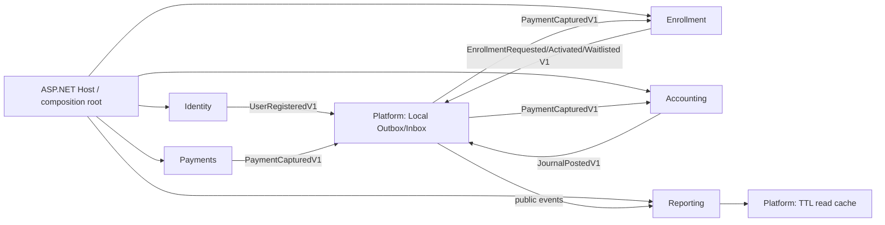

# Architecture: first working vertical slice

This repository applies the attached ABA PDF to a single deployable modular monolith. Business contexts are **authorities**, not code folders. The composition root may wire modules together, but **no context may reference another context's implementation project**.

> Source: ABA book, Chapter 35's cross-context enrollment flow and Chapter 17's Outbox/Inbox. This Phase 1 uses local file persistence and in-process dispatch only; the eventual target is transactional PostgreSQL/Wolverine.

## Explicit authority decisions

- **Identity** decides whether a user exists and may be registered; it owns unique email and user lifecycle.
- **Enrollment** decides capacity, enrollment status and activation. It consumes payment evidence, not payment internals.
- **Payments** owns a simulated payment capture and idempotency key; it does not create journals or activate enrollments.
- **Accounting** consumes `PaymentCapturedV1` and creates balanced, immutable posted journals; it never changes a posted journal.
- **Reporting** consumes only published public events and maintains its own rebuildable read projection.
- **Framework** owns serialization, reliable local delivery mechanics, persistence file format, and cache implementation, never a business decision.

## Failure behavior in the local demo

A context update and its outgoing event share **one JSON envelope**. `DurableContextStore<TState>.ExecuteAsync` writes the replacement file before a command returns. `ConsumeOnceAsync` commits the consumer state and inbox ID in the same replacement. The dispatcher acknowledges an outgoing message only after all subscribers succeed; on failure it schedules exponential retry and eventually dead-letters. Replays must be safe: the envelope's inbox IDs suppress duplicate delivery, and business state guards also handle semantically duplicated events with new envelope IDs.

**Limits:** this is not a relational transaction or cross-machine broker guarantee. One process per data directory is required; concurrent processes can overwrite one another. The sample does not yet support provider reconcilation, distributed contention, tenant data isolation, cloud readiness, real authentication or regulated financial/accounting requirements.

## Dependency and governance model

A business context's `.csproj` may reference another context's `*.Contracts` project, but never another's implementation. There is a single composition-root exception for `Academy.Host` and a test harness exception for the console smoke project. The enforceable checks live in `scripts/governance.py` and compare source project edges to `context-map.yaml`. Negative tests prove failures for illegal private dependencies, missing ownership metadata and unversioned contracts.

`AGENTS.md` and each `ai-rules.yaml` provide navigation instructions for coding agents. `docs/decisions/` preserves tradeoffs. Later phases must keep governance green as the infrastructure is replaced.